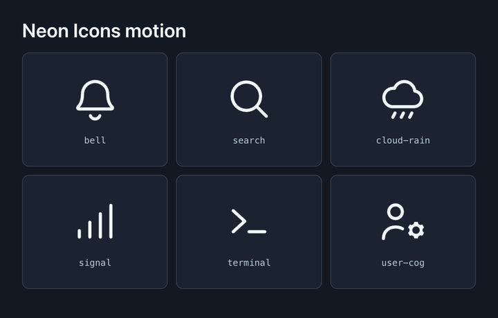

# Neon Icons

**530 cohesive modern interface icons** across **21 categories**, compiled into **6 first-class variants** (**3,180 SVGs**):

- **Styles**: `outline` and `filled`
- **Stroke weights**: `1.25`, `1.5`, and `2`
- **Grid**: `24×24` canvas with `2px` optical padding (`20×20` live area), shared keylines (`18px` circle, `16px` square, `14×18` portrait, `18×14` landscape), and unified `2.5px` primary corner radii
- **Filled artwork** uses a single path with transparent cutouts and inherits `currentColor`. Both styles use the same 24×24 viewBox.

## Run the showcase

```sh
pnpm install --frozen-lockfile
pnpm build
pnpm dev
```

Open the [local showcase](http://localhost:4173/). Hover over an icon or select it to replay its motion.

## Drawing conventions

Author shapes on the 24-unit grid. Use the selected stroke weight consistently for equivalent lines, with round caps and joins. Space repeated elements by their centerlines and build mirrored features around a shared axis. Preserve optical offsets where they serve the symbol, such as the rightward placement of a play triangle.

Every icon has a [geometry review](packages/core/src/geometry-intent.json) describing the feature inspected and any intended whole-icon symmetries. `pnpm verify` checks those symmetries, directional pairs, bounds, and rendering at 16, 24, and 48 px. For each of the six variants it also compares the export with a native SVG rendering of the source geometry at 192 px.

After building, run `pnpm verify --report` to check the packaged files against the manifest and regenerate the [per-icon audit](review/catalog-audit.csv). Its six numeric columns show the percentage of ink coverage that differs from the reference, with a 2% limit for antialiasing and curve approximation. An empty symmetry field indicates that the review focused on local features or an intentionally asymmetric silhouette.

## Workspace Packages

| Path | Description |
| --- | --- |
| `packages/core` | Canonical 24×24 icon geometry, shared family motifs, Skia PathOps compiler, bounds verifier, and PNG contact-sheet renderer |
| `packages/svg` | 3,180 optimized `.svg` files (`svg/{outline,filled}/{1.25,1.5,2}/*.svg`) + `manifest.json` |
| `packages/react` | Tree-shakeable React components (`@neon-icons/react`) with per-icon props, `NeonIconProvider`, dynamic `<NeonIcon />`, and static single-variant subpath exports |
| `apps/showcase` | Interactive icon browser with semantic search, live `Outline` / `Filled` / `Pair` modes, 24px optical keyline grid inspector, in-context UI preview, and one-click SVG/JSX export |

## React Usage

```tsx
import { HomeIcon, MailIcon, NeonIconProvider, NeonIcon } from '@neon-icons/react'

// Default: outline, 1.5px stroke, 24px
<HomeIcon />

// Switch variant and stroke directly on any icon (zero layout shift)
<HomeIcon variant="filled" stroke={1.5} size={20} />
<MailIcon variant="outline" stroke={1.25} size={18} />

// App-wide defaults with local overrides
<NeonIconProvider variant="outline" stroke={1.5} size={20}>
  <HomeIcon variant="filled" />
  <MailIcon />
</NeonIconProvider>

// Dynamic lookup by kebab-case name
<NeonIcon name="shield-check" variant="filled" stroke={2} />

// Single-variant static subpath imports for minimal bundle size
import { HomeIcon as HomeOutline } from '@neon-icons/react/outline/1.5'
import { HomeIcon as HomeFilled } from '@neon-icons/react/filled/1.5'
```

## Hover motion

The showcase plays a brief animation when you hover over an icon or focus its tile with the keyboard. Open an icon and choose **Replay motion** to preview it on a touch screen. All 530 icons support motion in both styles and at all three weights.

```tsx
import { AnimatedNeonIcon } from '@neon-icons/react'
import '@neon-icons/react/motion.css'

<button type="button" data-neon-trigger aria-label="Notifications">
  <AnimatedNeonIcon name="bell" size={20} />
</button>
```

Put `data-neon-trigger` on a button or link to animate the icon when the control is hovered or receives keyboard focus. For an explicit replay, pass `playOnMount` and change the component’s React `key`. Where the artwork allows it, marks such as badge glyphs, signal bars, and weather details have their own timing and pivots. Each animation settles back to the original artwork and respects the system reduced-motion setting.



## Commands

```sh
pnpm build       # Compile all 3,180 SVGs, React package, and Showcase app
pnpm verify      # Verify bounds and rasterize all 3,180 variants at 16, 24, and 48px
pnpm typecheck   # Type-check core, react, and showcase packages
pnpm dev         # Launch interactive showcase at http://localhost:4173
pnpm sheets      # Render high-DPI visual contact sheets of all 530 icons
```
